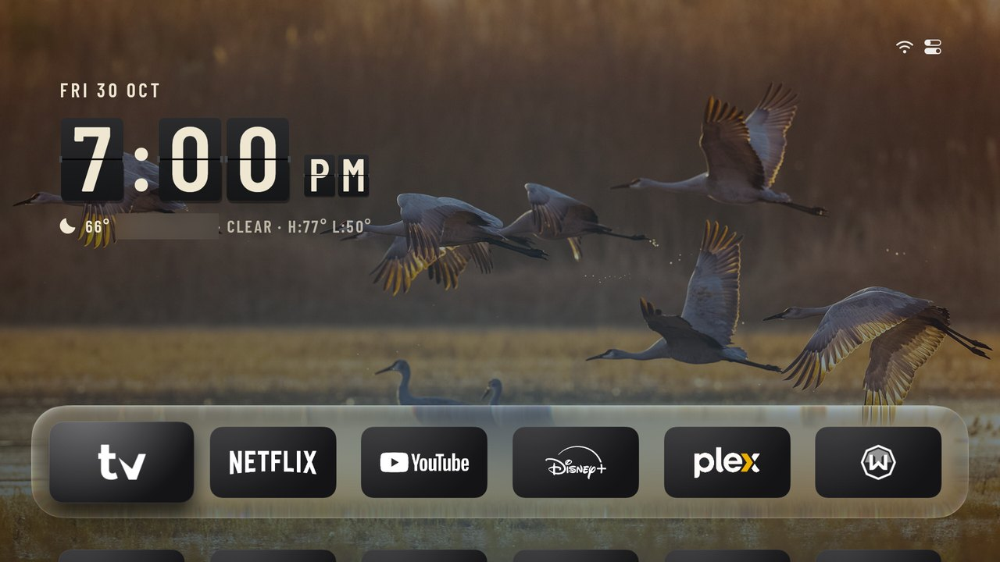
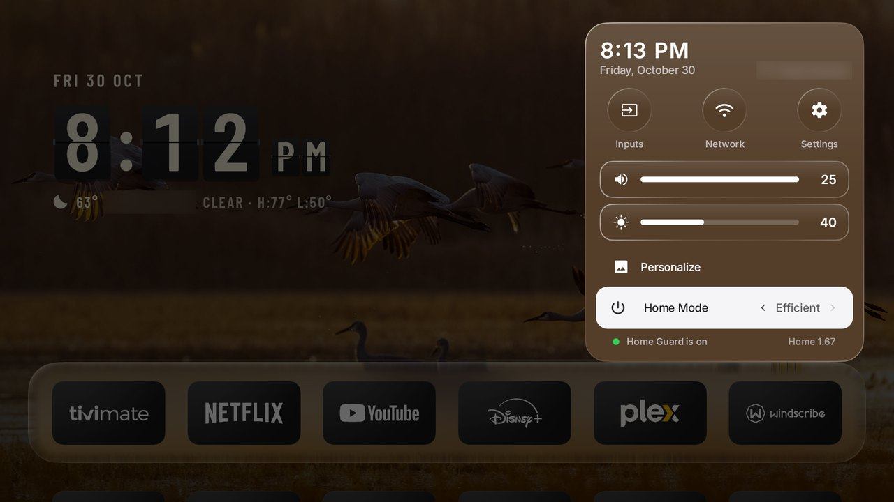
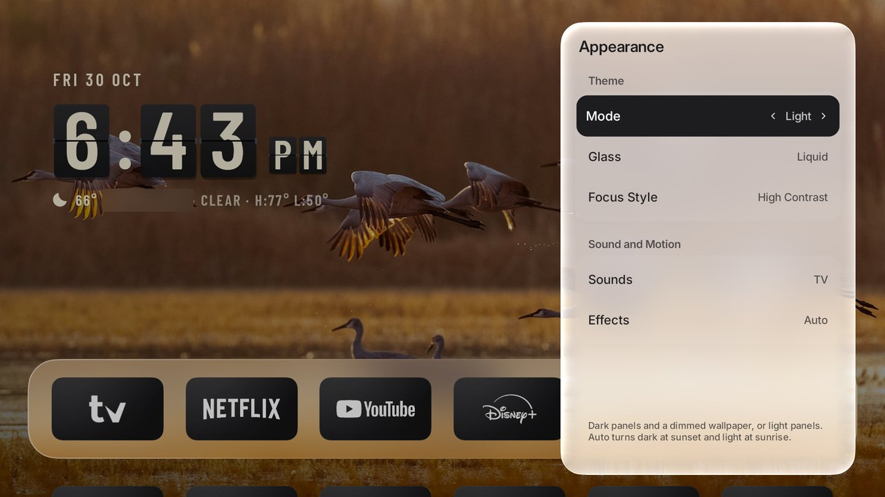
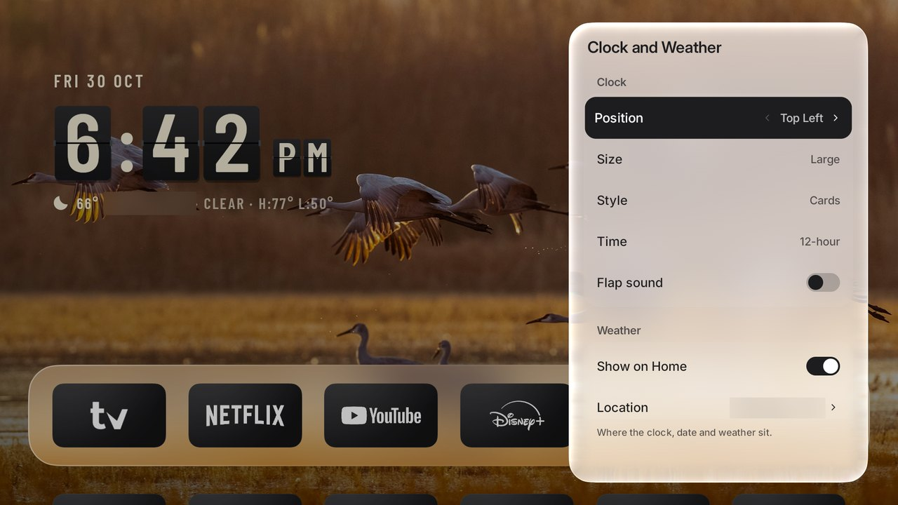

# TV CleanSlate

[](https://github.com/manishslal/TV-CleanSlate/actions/workflows/android.yml)
[](LICENSE)

**A calm, ad-free Home for the TVs you already own, plus a safe way to clear out what came with them.**

TV CleanSlate replaces the ad-filled home screen on Android TV and Google TV devices, brings the same look to a rooted LG webOS TV, and documents how to debloat each device one reversible step at a time. Everything here was tested on real hardware.

It stands on the work of other open source projects. The Android app is a fork of [**Aerial**](https://github.com/pengchujin/aerial-tv) by pengchujin and its contributors. See [Credits](#credits).



| Control Center | Appearance |
|---|---|
|  |  |

| Layout and Tiles | Clock and Weather |
|---|---|
|  |  |

*The city shown on screen is blurred. Brand logos in these screenshots come from a private logo pack that is not included in this repository. A normal build draws each tile from the app's own icon.*

## What's here

| Part | What it does | Start here |
|---|---|---|
| **Android Home** | A Home app for Android TV and Google TV, built with Kotlin and Jetpack Compose | [android/](android/README.md) |
| **webOS Home** | The same look as a web app, for a rooted LG TV | [webos/](webos/README.md) |
| **Device kit** | Scripts to back up a TV, switch launchers and restore stock | [scripts/](scripts/README.md) |
| **Guides** | Setup, safety, troubleshooting and agent-ready debloat prompts | [guides/](guides/getting-started.md) |
| **Device logs** | What was changed on each TV and how to undo it | [devices/](devices/README.md) |

## Features

| Feature | Android Home | webOS Home |
|---|---|---|
| Aerial film wallpapers | Yes | Yes |
| Flip-card clock, date and weather | Yes | Yes |
| Dark glass tiles and focus glow | Yes | Yes |
| Personalize panel | Yes | Yes |
| Liquid Glass | Android 13+ | No |
| Light, Dark and Auto (sunset to sunrise) themes | Yes | Yes |
| Screensaver with headlines by topic | Yes | Yes |
| Plex videos and photos | Yes | No |
| Home Guard, which keeps Home from being replaced | Yes | Uses CleanYourTV |
| Folders, hidden apps and tile moves | Yes | Yes |
| Parental PIN | Yes | Not checked on a real remote |
| HDMI inputs in Control Center | Yes | Yes |
| Phone setup page on your network | Yes | No |
| Home Mode | Yes | Lite effects only |
| Screen reader labels | Yes | No |
| Five languages (English, Chinese, Russian, Ukrainian, Kazakh) | Yes | English |

Android Home runs on Android 5.0 and newer. Most testing here was on Android 9 to 14.

### Home Mode, measured

Measured on an onn 4K Streaming Box with 2 GB of RAM. Full method: [PERFORMANCE.md](android/docs/PERFORMANCE.md).

| | Full | Custom (measured setup) | Efficient |
|---|---:|---:|---:|
| Memory at idle | 227 MB | 158 MB | 141 MB |
| Memory with Control Center open | 274 MB | 167 MB | 149 MB |
| Memory in the screensaver | 236 MB | 186 MB | 146 MB |
| CPU at idle | 57% | 0% | 0% |
| Typical frame | 82 ms | 25 ms | 14 ms |
| Slow frames | 77% | 9% | 3% |

## Supported devices

| Device | OS | Home | Debloat | Log |
|---|---|---|---|---|
| onn 4K Streaming Box | Google TV 14 | Android Home | Yes | [Log](devices/onn-4k-streaming-box/CHANGELOG.md) |
| onn 4K Plus | Google TV 14 | Android Home | Yes | [Log](devices/onn-4k-plus/CHANGELOG.md) |
| NVIDIA SHIELD TV (2019 tube) | Android TV 11 | Android Home | Yes | [Log](devices/nvidia-shield-tube/CHANGELOG.md) |
| TCL C02_4K_US | Android TV 9 | Android Home | Yes | [Log](devices/tcl-c02-4k-us/CHANGELOG.md) |
| LG 50UP8000PUA | webOS 6.5, rooted | webOS Home | Yes | [Log](devices/lg-50up8000pua/CHANGELOG.md) |
| Hisense SmartTV 4K | Android TV 12 | No | **No**, changes don't last | [Log](devices/hisense-smarttv-4k/CHANGELOG.md) |
| Fire TV Stick 4K (2nd gen) | Fire OS 8 | No | Yes | [Log](devices/fire-tv-stick-4k-gen2/CHANGELOG.md) |

Details, limits and a machine-readable list: [docs/SUPPORTED_DEVICES.md](docs/SUPPORTED_DEVICES.md) and [devices/devices.json](devices/devices.json). The Android app also carries Aerial's notes for many other TVs in [android/docs/devices/](android/docs/devices/).

## Quick start

You need ADB, JDK 17, the Android SDK, and network debugging turned on for the TV. No prebuilt APK is published yet, so you build your own.

```bash
git clone https://github.com/manishslal/TV-CleanSlate.git
cd TV-CleanSlate/android
BUILD=1 TV=<tv-ip>:5555 tools/install.sh
```

The full walkthrough is in [Getting started](guides/getting-started.md). Stuck? See [Troubleshooting](guides/troubleshooting.md).

## Privacy

There are no ads, accounts or analytics. Android Home only contacts these services, and only for the features you use:

| Service | Used for |
|---|---|
| Apple | Aerial films |
| Open-Meteo | Weather and sunset times |
| ipinfo.io | Approximate location for weather |
| Microsoft Bing | Photo of the day |
| Google News | Headlines |
| plex.tv and your Plex server | Your videos and photos |

It doesn't contact Aerial's servers or check for app updates.

## Safety rules

- Disable packages instead of uninstalling them, so every change can be undone.
- Never touch input, remote, keyboard, Wi-Fi or update packages.
- Change a few things at a time and reboot to check.
- Never copy a debloat list from one model to another.
- Log every change and how to undo it.

Read the full [safety guide](guides/safety.md) first.

Rooting an LG TV can void support and is at your own risk. This project comes with no warranty.

## Repository layout

```text
android/    Android Home app (fork of Aerial)
webos/      webOS Home for rooted LG TVs
scripts/    Backup, launcher switching and restore scripts
guides/     Debloat and safety guides
devices/    Per-device logs, restore scripts and devices.json
logos/      Logo manifest (app IDs only, no artwork)
docs/       Supported devices, architecture, screenshots and research
```

AI coding agents should start with [AGENTS.md](AGENTS.md).

## Credits

TV CleanSlate would not exist without these projects.

- **[Aerial](https://github.com/pengchujin/aerial-tv)** by pengchujin and contributors is the base of the Android app. Its commit history is kept in this repository, so the original authors stay credited on their work.
- **[CleanYourTV](https://github.com/Gathin23/cleanyourtv)** by Gathin provides the LG Home takeover and debloat tools.
- **[Free My TV](https://github.com/simbasjungles/free-my-tv)** shaped the dark tile treatment and the launcher-switching approach.
- **[XMB TV Home](https://github.com/sanangoyal/XBM-TV-Home)** by Sanan Goyal inspired the backup, restore and agent-friendly kit.
- **[SlopBro](https://github.com/throwaway96/slopbro)** and **[Homebrew Channel](https://github.com/webosbrew/webos-homebrew-channel)** make the LG root and app loading possible.

The full list, with licenses and exactly how each project was used, is in [CREDITS.md](CREDITS.md). If you like the Android app, please also star and support [Aerial](https://github.com/pengchujin/aerial-tv).

## License

[MIT](LICENSE). The Android app keeps Aerial's original [license](android/LICENSE) and [notices](android/NOTICE.md). Fonts and other bundled material keep their own licenses, listed in [CREDITS.md](CREDITS.md).

TV CleanSlate is not affiliated with or endorsed by Aerial, Apple, Google, LG, NVIDIA, Amazon, onn, TCL, Hisense or any streaming service. All trademarks belong to their owners.
