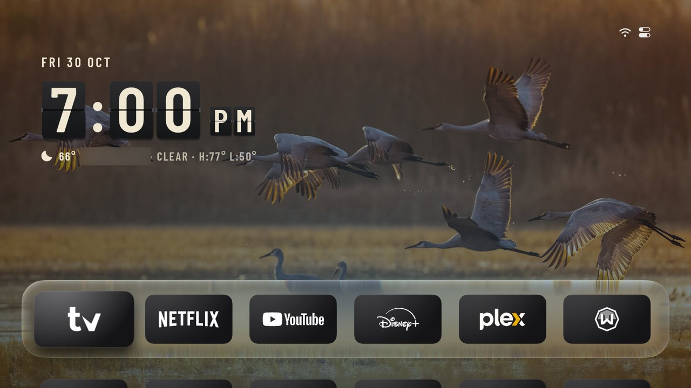
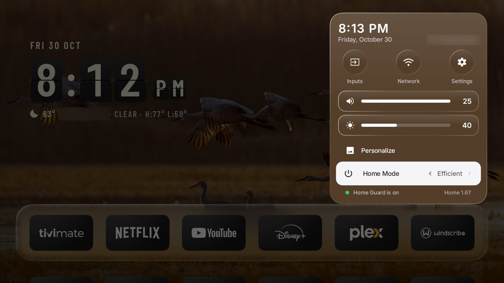
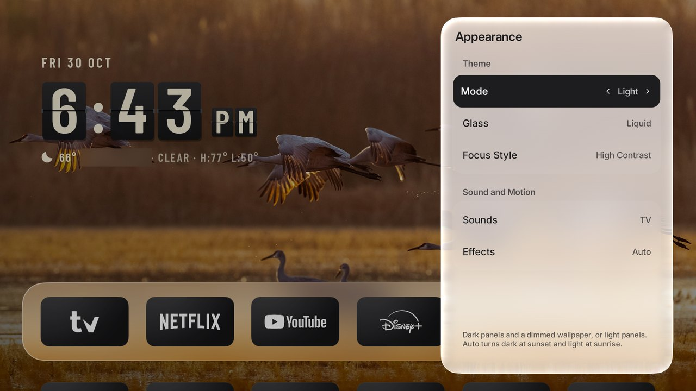
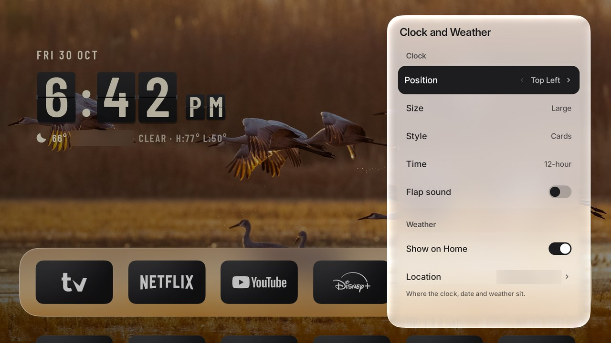

# TV CleanSlate

[](https://github.com/manishslal/TV-CleanSlate/actions/workflows/android.yml)
[](https://github.com/manishslal/TV-CleanSlate/actions/workflows/parity.yml)
[](https://github.com/manishslal/TV-CleanSlate/actions/workflows/checks.yml)
[](LICENSE)

**A calm, ad-free Home for the TVs you already own, plus a safe way to clear out what came with them.**

TV CleanSlate replaces the ad-filled home screen on Android TV, Google TV and Fire TV devices, brings the same look to a rooted LG webOS TV and to older Samsung Tizen TVs without root, and documents how to debloat each device one reversible step at a time. Everything here was built and tried on real TVs, and each [device log](devices/README.md) says what was and wasn't checked.

**Status (2026-11-05):** tested by hand on the ten TVs and boxes listed under [Supported devices](#supported-devices), not on any others. The workflow badges above only show that the Android app builds and the parity and repository checks pass; they don't test a TV. No release is published yet.

It stands on the work of other open source projects. The Android app is a fork of [**Aerial**](https://github.com/pengchujin/aerial-tv) by pengchujin and its contributors. See [Credits](#credits).



| Control Center | Appearance |
|---|---|
|  |  |

| Layout and Tiles | Clock and Weather |
|---|---|
|  |  |

*The city shown on screen is blurred. Brand logos in these screenshots come from a private logo pack that is not included in this repository. A normal build draws each tile from the app's own icon.*

## Before you start

This is one person's project, tested on the TVs in one home. It is shared so others can learn from it and pick what suits them. Nothing here is needed to use your TV, and you can stop at any step.

| What you'd do | Risk | How to undo it |
|---|---|---|
| Install Android Home | Low to medium. Your stock Home stays installed, but the installer grants Home system permissions and may turn on an accessibility service (Home Guard) without asking again | `tools/restore.sh --uninstall` takes it all back ([details](guides/getting-started.md#3-build-and-install)) |
| Make it the default Home on Google TV (`04-disable-stock-launcher.sh`) | Medium. Disables (never uninstalls) the stock launcher and setup wizard | `scripts/99-restore-stock.sh` |
| Debloat over ADB | Medium. A wrong package can break inputs, the remote or Wi-Fi | Re-enable the package; each device log lists the undo |
| Samsung web Home | Low to medium. Needs Developer Mode, no root | Uninstall the app and turn off Developer Mode |
| LG web Home | **High.** Needs a root exploit (SlopBro) and replaces LG's Home | Home and its start-up hooks come out ([webos/README](webos/README.md#risks-and-undo)); the root itself can't be taken back |

- **Who it's for:** people comfortable with ADB or a command line, who want to see and undo every change.
- **Who it's not for:** anyone who needs the TV under warranty support, relies on the TV maker's own features (voice, ads-funded channels, account services), or can't take a TV out of use for an evening if something goes wrong.
- **Device logs are records, not instructions.** [devices/](devices/README.md) says what one owner chose for one TV, such as blocking an LG's updates. Those were personal choices with trade-offs (no security fixes), not recommendations.
- **The scripts in `scripts/` ask before they change anything**, and say how to undo it. The restore script never asks, so it works in a hurry. Android Home's installer (`android/tools/install.sh`) doesn't ask once started; the [getting started guide](guides/getting-started.md) lists what it does first.

## What's here

| Part | What it does | Start here |
|---|---|---|
| **Android Home** | A Home app for Android TV, Google TV and Fire TV, built with Kotlin and Jetpack Compose | [android/](android/README.md) |
| **webOS Home** | The same look as a web app, for a rooted LG TV | [webos/](webos/README.md) |
| **Samsung Tizen** | A web Home running on 2017 and 2018 TVs, with no root. The Home button opens Smart Hub first, then Home reopens over it | [tizen/](tizen/README.md) |
| **Device kit** | Scripts to back up a TV, disable the stock launcher, switch launchers and restore stock | [scripts/](scripts/README.md) |
| **Guides** | Setup, safety, troubleshooting and agent-ready debloat prompts | [guides/](guides/getting-started.md) |
| **Device logs** | What was changed on each TV and how to undo it | [devices/](devices/README.md) |
| **Cut-out service** | An optional home-server container that lets a wallpaper's subject stand in front of the clock | [server/cutout/](server/cutout/README.md) |

## Features

| Feature | Android Home | webOS Home |
|---|---|---|
| Aerial film wallpapers | Yes | Yes |
| Flip-card clock, date and weather | Yes | Yes |
| Clock Small, Large or Huge; top left, center, right or Auto (where the picture is calmest) | Yes | Yes |
| Daily wallpapers from Bing, NASA Earth Observatory, Wikimedia Commons and Google Earth View, or a different source each day | Yes | Yes |
| The wallpaper's subject in front of the clock, with a home cut-out service | Yes | No |
| Calm interface sounds of its own (`tools/make-sounds.py`) | Yes | Yes |
| Clear, Dark and Color tiles | Yes | Yes |
| Focus glow in the app's color | Yes | Yes |
| Personalize panel | Yes | Yes |
| Liquid Glass | Android 13+ | No |
| Light, Dark and Auto (sunset to sunrise) themes | Yes | Yes |
| Screensaver with headlines by topic | Yes | Yes |
| Plex videos and photos | Yes | No |
| Home Guard, which keeps Home from being replaced | Yes, FireKeeper on Fire OS 6 | Uses CleanYourTV |
| Folders, hidden apps and tile moves | Yes | Yes |
| Parental PIN | Yes | Not checked on a real remote |
| HDMI inputs in Control Center | Yes | Yes |
| Phone setup page on your network | Yes | No |
| Home Mode | Yes | Auto, Full and Efficient; Samsung starts on Efficient |
| Frosted dock and app grid over any wallpaper, under the wallpaper's dim | Yes | Yes |
| Screen reader labels | Yes | No |
| Five languages (English, Chinese, Russian, Ukrainian, Kazakh) | Yes | English |

Android Home runs on Android 5.0 and newer. Most testing here was on Android 9 to 14.

### Stock launcher off

On the onn 4K Streaming Box, `scripts/04-disable-stock-launcher.sh` makes Home Android's real default and removes the stock launcher and setup wizard processes. They used 79 MB two minutes after boot, and the launcher reached 141 MB with its services after long uptime ([device log](devices/onn-4k-streaming-box/CHANGELOG.md)).

### Home Mode, measured

Measured on an onn 4K Streaming Box with 2 GB of RAM. Full method: [PERFORMANCE.md](android/docs/PERFORMANCE.md).

| | Full | Custom (measured setup) | Efficient |
|---|---:|---:|---:|
| Memory at idle | 227 MB | 158 MB | 141 MB |
| Memory with Control Center open | 274 MB | 167 MB | 149 MB |
| Memory in the screensaver | 236 MB | 186 MB | 146 MB |
| CPU at idle | 57% | 0% | 0% |
| Typical frame | 82 ms | 25 ms | 14 ms |
| Slow frames | 77% | 9% | 3% |

## Supported devices

| Device | OS | Home | Latest build on it | Debloat | Log |
|---|---|---|---|---|---|
| onn 4K Streaming Box | Google TV 14 | Android Home | 1.67-mh37 | Yes | [Log](devices/onn-4k-streaming-box/CHANGELOG.md) |
| onn 4K Plus | Google TV 14 | Android Home | 1.67-mh1 | Yes | [Log](devices/onn-4k-plus/CHANGELOG.md) |
| NVIDIA SHIELD TV (2019 tube) | Android TV 11 | Android Home | 1.67-mh37 | Yes | [Log](devices/nvidia-shield-tube/CHANGELOG.md) |
| TCL C02_4K_US | Android TV 9 | Android Home | 1.67-mh2 | Yes | [Log](devices/tcl-c02-4k-us/CHANGELOG.md) |
| LG 50UP8000PUA | webOS 6.5, rooted | Web Home | 2026-11-05 | Yes | [Log](devices/lg-50up8000pua/CHANGELOG.md) |
| Samsung UN50MU6070 | Tizen 3.0 | Web Home, on Smart Hub | 2026-11-01 | Partly, no root | [Log](devices/samsung-un50mu6070/CHANGELOG.md) |
| Samsung UN55NU6900 | Tizen 4.0 | Web Home, on Smart Hub | 2026-11-01 | Partly, no root | [Log](devices/samsung-un55nu6900/CHANGELOG.md) |
| Hisense SmartTV 4K | Android TV 12 | No | | **No**, changes don't last | [Log](devices/hisense-smarttv-4k/CHANGELOG.md) |
| Fire TV Stick 4K (1st gen) | Fire OS 6.7 | Android Home with FireKeeper | 1.67-mh37 | Yes | [Log](devices/fire-tv-stick-4k-gen1/CHANGELOG.md) |
| Fire TV Stick 4K (2nd gen) | Fire OS 8 | No | | Yes | [Log](devices/fire-tv-stick-4k-gen2/CHANGELOG.md) |

Android Home's latest build is 1.67-mh37: Aerial 1.67, plus this fork's 37th build on top of it ("mh" counts the fork's builds). The web Home has no version number; its date is the day it was last installed. The Samsungs have not had the web Home since 2026-11-01, so they lack this month's changes until it is installed again.

Details, limits and a machine-readable list: [docs/SUPPORTED_DEVICES.md](docs/SUPPORTED_DEVICES.md) and [devices/devices.json](devices/devices.json). The Android app also carries Aerial's notes for many other TVs in [android/docs/devices/](android/docs/devices/).

## Quick start

Read the [safety guide](guides/safety.md) and [Before you start](#before-you-start) first. You need ADB, JDK 17, the Android SDK, and network debugging turned on for the TV. No prebuilt APK is published yet, so you build your own.

```bash
git clone https://github.com/manishslal/TV-CleanSlate.git
cd TV-CleanSlate/android
BUILD=1 TV=<tv-ip>:5555 tools/install.sh
```

The full walkthrough is in [Getting started](guides/getting-started.md). Stuck? See [Troubleshooting](guides/troubleshooting.md).

## Privacy

There are no ads, accounts or analytics. Android Home only contacts these services, and only for the features you use:

| Service | Used for |
|---|---|
| Apple (`sylvan.apple.com`) | Aerial films |
| Open-Meteo | Weather, sunset times and city search |
| ipinfo.io | Approximate location for weather |
| Microsoft Bing | Photo of the day |
| NASA (`science.nasa.gov`) | Earth Observatory Image of the Day |
| Wikimedia (`api.wikimedia.org`, `upload.wikimedia.org`) | Commons Picture of the Day, shown with its author and license |
| Google (`gstatic.com`) | Google Earth View pictures |
| Google News | Headlines |
| plex.tv and your Plex server | Your videos and photos |
| Your own cut-out server (optional) | The wallpaper's subject. Off unless you give it an address |

The web Homes (LG and Samsung) contact the same services except ipinfo.io: there you pick the city. Neither Home contacts Aerial's servers or checks for app updates.

## Safety rules

- Disable packages instead of uninstalling them, so every change can be undone.
- Never touch input, remote, keyboard, Wi-Fi or update packages.
- Change a few things at a time and reboot to check.
- Never copy a debloat list from one model to another.
- Log every change and how to undo it.

Read the full [safety guide](guides/safety.md) first.

Rooting an LG TV can void support and is at your own risk. This project comes with no warranty.

## FAQ

**Will this void my warranty?** Possibly. Disabling packages or installing a Home doesn't remove anything, but a maker can still decline support for a changed TV, and rooting an LG can void it. Read [Before you start](#before-you-start) first.

**Can I undo everything?** Almost. `tools/restore.sh --uninstall` and `scripts/99-restore-stock.sh` put an Android TV back to stock, and each [device log](devices/README.md) lists its undo steps. The LG root itself can't be taken back.

**Does it collect data?** No. There are no ads, accounts or analytics, and the [Privacy](#privacy) table lists every service Home contacts.

**Do I need root?** No for Android, Google TV, Fire TV and Samsung. Yes for LG webOS, which is the high-risk path.

**Will my TV still get updates?** Yes, unless you block them. The guides say to leave update packages alone; blocking updates on the LG was one owner's choice, and it means no security fixes.

**Why is there no APK download yet?** Releases are planned. For now you build it yourself, as in [Quick start](#quick-start).

**Is this affiliated with Google, Amazon, LG or Samsung?** No. It is an independent hobby project, and all trademarks belong to their owners (see [License](#license)).

## Terms used here

| Term | Meaning |
|---|---|
| mh37 | This fork's build number on top of Aerial 1.67 |
| Home Guard | An accessibility service that answers the Home key with Home, on TVs that keep sending Home back to their own launcher |
| FireKeeper | Home Guard's stand-in on Fire OS 6, which never runs accessibility services: it brings Home to the front instead |
| CleanYourTV | Another project's LG tool that lets a homebrew app replace LG's Home, and turns off LG's ads and tracking |
| Home Mode | Full (every effect), Efficient (still pictures, fewer effects, less memory) or Auto (picks for the device) |
| Liquid Glass | The bending, see-through glass Android 13 and later draw; older TVs and the web draw plain frosted glass |
| Parity | Keeping the Android and web Homes alike. `docs/parity.json` lists every feature and where it works, and a check stops a change that forgets to update it |

## Repository layout

```text
android/    Android Home app (fork of Aerial)
webos/      webOS Home for rooted LG TVs
scripts/    Backup, launcher switching and restore scripts
guides/     Debloat and safety guides
devices/    Per-device logs, restore scripts and devices.json
logos/      Logo manifest (app IDs only, no artwork)
docs/       Supported devices, architecture, screenshots and research
tizen/      Samsung Tizen build of the web Home
server/     Optional home-server services (the cut-out service)
tools/      Generators for bundled material (the interface sounds)
```

AI coding agents should start with [AGENTS.md](AGENTS.md).

## Credits

TV CleanSlate would not exist without these projects.

- **[Aerial](https://github.com/pengchujin/aerial-tv)** by pengchujin and contributors is the base of the Android app. Its commit history is kept in this repository, so the original authors stay credited on their work.
- **[CleanYourTV](https://github.com/Gathin23/cleanyourtv)** by Gathin provides the LG Home takeover and debloat tools.
- **[Free My TV](https://github.com/simbasjungles/free-my-tv)** shaped the dark tile treatment and the launcher-switching approach.
- **[XMB TV Home](https://github.com/sanangoyal/XBM-TV-Home)** by Sanan Goyal inspired the backup, restore and agent-friendly kit.
- **[SlopBro](https://github.com/throwaway96/slopbro)** and **[Homebrew Channel](https://github.com/webosbrew/webos-homebrew-channel)** make the LG root and app loading possible.

The full list, with licenses and exactly how each project was used, is in [CREDITS.md](CREDITS.md). If you like the Android app, please also star and support [Aerial](https://github.com/pengchujin/aerial-tv).

## License

[MIT](LICENSE). The Android app keeps Aerial's original [license](android/LICENSE) and [notices](android/NOTICE.md). Fonts and other bundled material keep their own licenses, listed in [CREDITS.md](CREDITS.md).

TV CleanSlate is not affiliated with or endorsed by Aerial, Apple, Google, LG, NVIDIA, Amazon, onn, TCL, Hisense or any streaming service. All trademarks belong to their owners.
