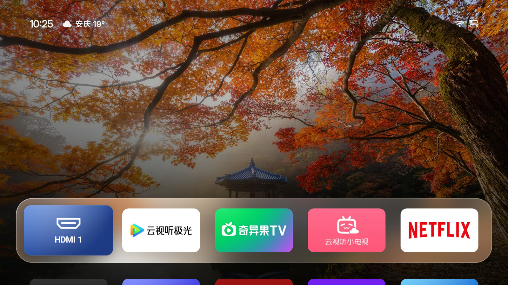
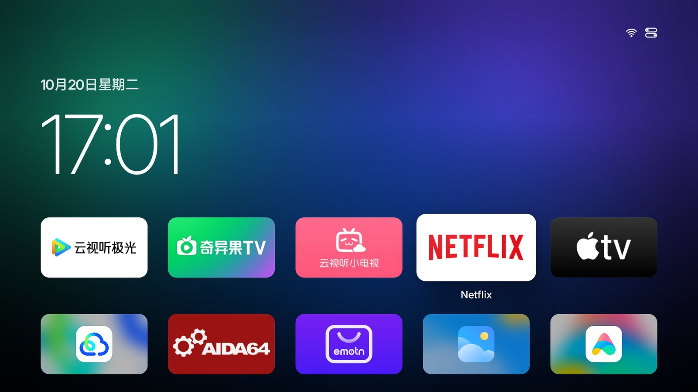
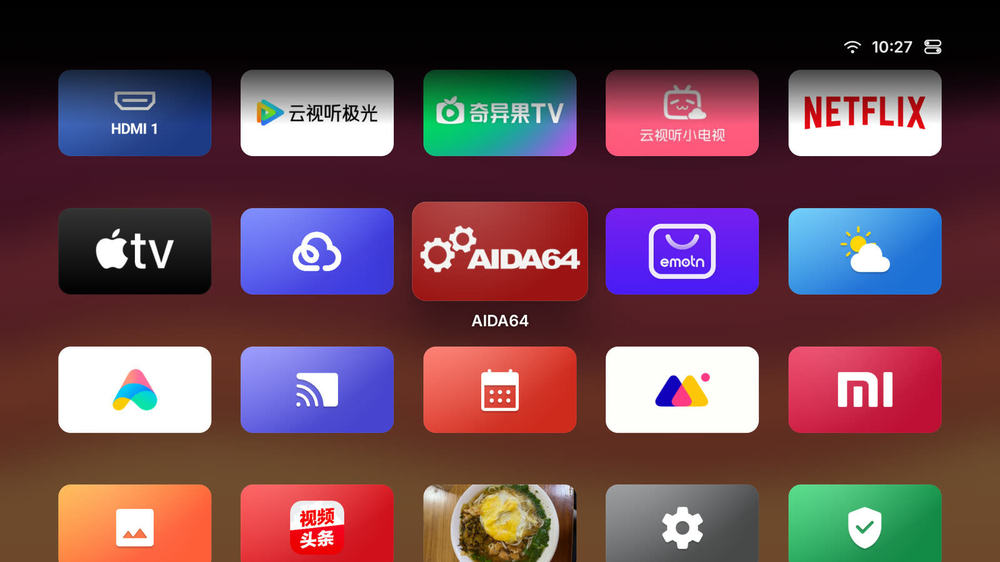
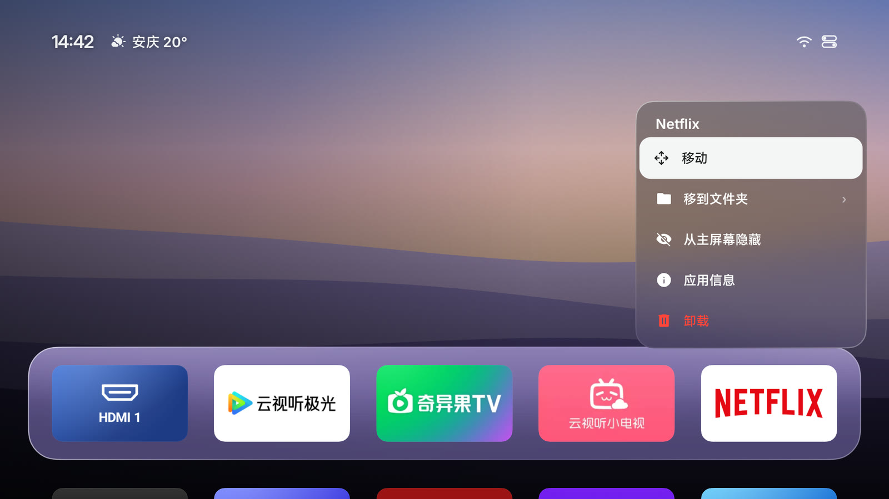
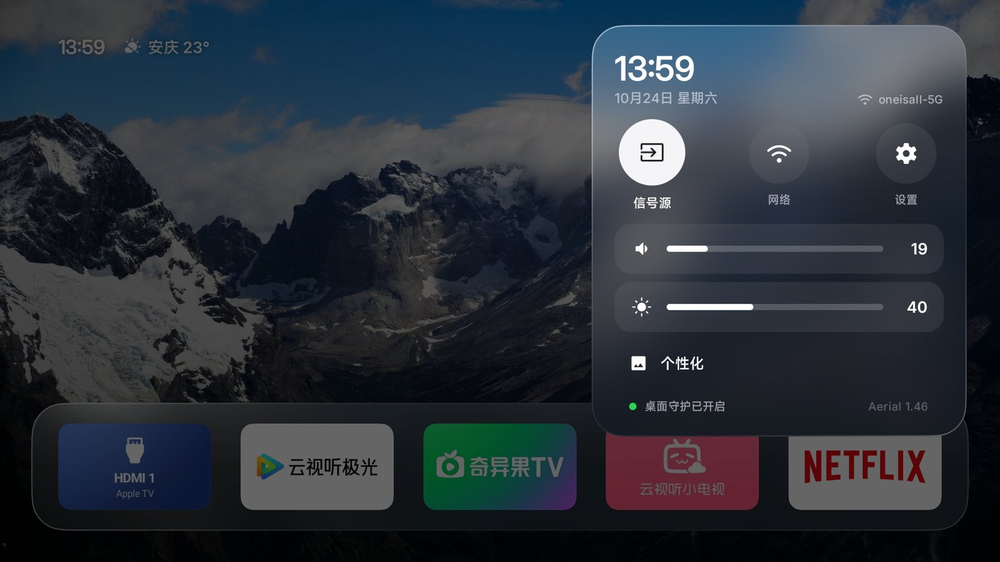
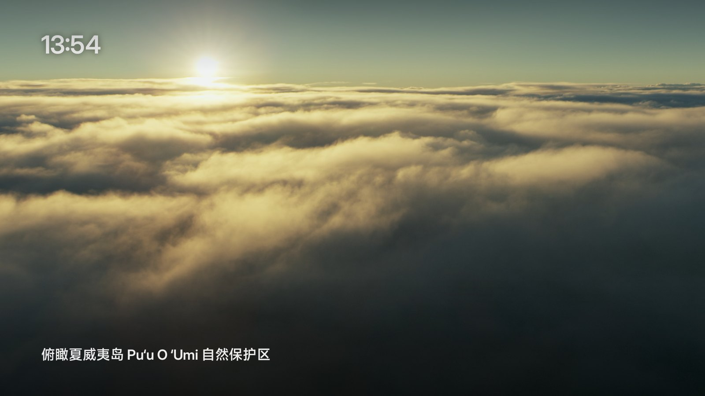
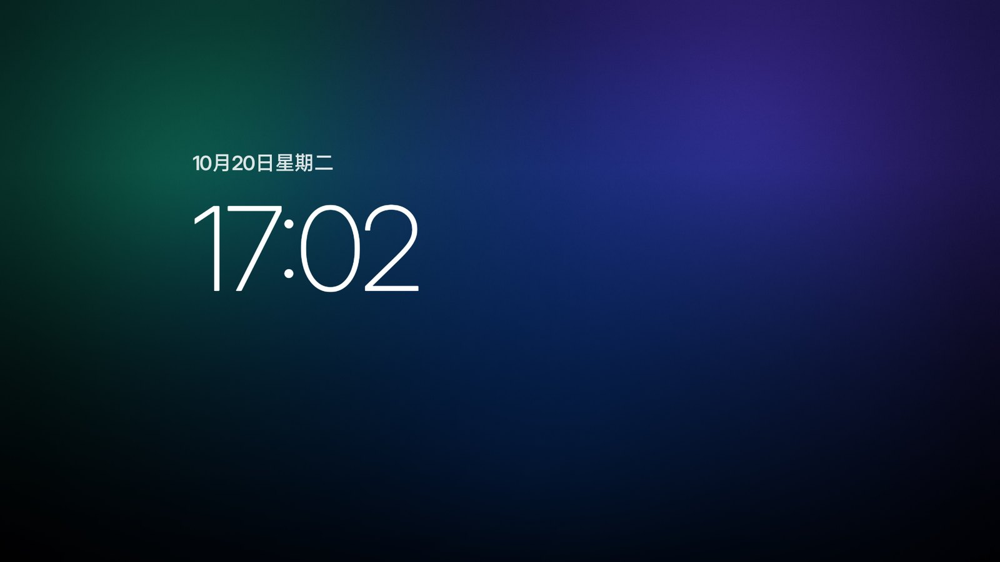
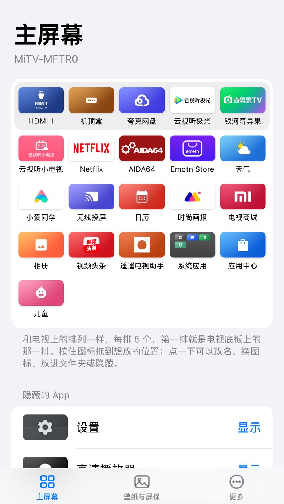

<div align="center">


# Aerial

**A calm home screen for Android TV.**

A tvOS-style launcher with no ads and no recommendation feeds. Just your apps, your wallpaper and Apple TV's aerial screensavers.<br>
Built for the Xiaomi, TCL and other TVs sold in China. It takes over at boot and survives standby.

[中文](README.md) · **English**

<a href="https://aerial.qust.me/en/"></a>
<a href="https://github.com/pengchujin/aerial-tv/releases/latest"></a>
<a href="#install-with-an-agent-recommended"></a>
<a href="#step-1-turn-on-adb-debugging"></a>

<a href="https://github.com/pengchujin/aerial-tv/releases/latest"></a>
<a href="LICENSE"></a>




| The TV's stock home screen | With Aerial |
|:---:|:---:|
|  |  |

</div>

## Features

### Home

<p align="center">
  
  
</p>

- **Clock**: a large, thin clock over your wallpaper, which darkens toward the bottom and left so everything stays readable. Scroll down and it tucks into the status bar.
- **App grid**: five apps per row. The focused app lifts and shows its name, with a white ring so you can spot it from the couch. Prefer the plain tvOS look? Set Focus Style to Standard in Control Center → Aerial Settings.
- **Icons**: apps with a TV banner show it. Square icons fill the tile with their own color, and adaptive icons split into layers for a parallax effect.
- **Every app**: including system apps with no launcher entry, like Xiaomi's App Store, Media Player and Mi Home.
- **Input tiles**: pin HDMI, AV or the antenna to Home and switch to it in one press (Control Center → Inputs → Show on Home).
- **Back button**: works like tvOS. In the grid it jumps to the top row; on the top row it starts the screensaver.

### Long press



Hold OK to **Move** (other tiles make room), **Hide from Home**, open **App Info** or **Uninstall**.

### Control Center



Press the remote's menu button (≡), or press Up from the top row. You get inputs (with HDMI-CEC devices), network and settings, volume and brightness sliders, plus Wallpaper & Screensaver, Hidden Apps and Aerial Settings. Network and settings open your TV's own panels.

### Screensaver

<p align="center">
  
  
</p>

- **Aerial**: 114 aerial films from Apple TV, streamed from Apple's servers, with location names as the camera moves. Left and right skip between films.
- **Photos**: the daily photos and your own, slowly panning.
- **Clock**: moves every minute to prevent burn-in.

On TVs that use Android's standard screensaver (TCL, for one), Aerial becomes the system screensaver. Xiaomi uses its own, so Aerial starts first whenever Home sits idle, ahead of Xiaomi's ad-filled one.

### Wallpaper and phone setup

<p align="center">
  
  
</p>

- **Wallpaper**: Bing's photo of the day, eight built-in gradients, or your own photos.
- **Phone setup**: scan the QR code in the wallpaper panel to upload photos, pick a wallpaper or change the screensaver from your phone. The page is only open while the panel is, behind a random token.

## Install

No root needed. Aerial **never uninstalls or disables system apps**, and one command undoes everything.

### Step 1: Turn on ADB debugging

Put your computer and TV on the same network. Find the TV's IP address (usually under Settings → Network or About), then turn on ADB. Menus on Chinese firmware are in Chinese, so their names are in brackets.

| TV | How |
|---|---|
| **Xiaomi / Redmi** | Settings (设置) → About (关于) → press OK on **Model** (产品型号) until it says developer mode is on. Then Settings → Account & Security (账号与安全): turn on **ADB debugging** (ADB 调试) and **Install unknown apps** (安装未知来源的应用) |
| **TCL / FFALCON** | Settings (设置) → About (关于) → **Device info** (本机信息), then press **Up, Down, Left, Right** on the remote, less than a second apart. A **More** (更多) group appears at the bottom; turn on **ADB** there |
| **Android TV / Google TV**, Hisense and others | Settings → Device Preferences → About → press **Build** 7 times. Then turn on **USB debugging** in Developer options (sometimes called Network debugging or ADB debugging) |

The first time your computer connects, the TV asks whether to allow USB debugging. Choose **Allow** and check **Always allow**.

### Install with an agent (recommended)

Paste this into an agent that can run commands on your computer, like Claude Code, Codex or Cursor. Replace `<TV-IP>` with your TV's IP address:

```text
Please install Aerial, an open-source home screen for Android TV (https://github.com/pengchujin/aerial-tv), on my TV, and make it the home screen the TV starts into.
My TV's IP address is <TV-IP>.

Steps:
1. Read the Install section of the README and the notes in docs/devices/.
2. Check that adb, curl and python3 are available. adb is optional: the installer downloads Google's platform-tools if it's missing.
3. Run adb connect <TV-IP>:5555. If it can't connect, tell me to turn on ADB debugging on the TV as the README describes. If it says unauthorized, tell me to choose Allow on the TV.
4. Run the installer:
   curl -fsSL https://raw.githubusercontent.com/pengchujin/aerial-tv/main/tools/get.sh | KEEP_ADB=1 TV=<TV-IP> bash
   On a TCL TV, a 多屏互动 (screen sharing) prompt appears in the top-right corner. Tell me to accept it on the TV.
5. Confirm that app.orchard.tv is in front with adb shell dumpsys window | grep mCurrentFocus. Then, once I agree, run adb reboot and confirm the TV starts into Aerial.
6. Don't uninstall or disable any system app, and don't delete anything on the TV that this install didn't create. If something fails, show me the exact output and check docs/devices/.
```

### One command (macOS / Linux)

```bash
curl -fsSL https://raw.githubusercontent.com/pengchujin/aerial-tv/main/tools/get.sh | KEEP_ADB=1 TV=192.168.1.20 bash
```

The script installs the latest APK, grants the permissions only ADB can grant (see below), precompiles the app so it runs smoothly, takes over Home and the screensaver, and lets Aerial start at boot.

- `KEEP_ADB=1`: if the TV turns ADB debugging off (Xiaomi does on wake), Aerial turns it straight back on. Leave it out if you don't need it.
- **Firmware that won't install home-screen apps**: add `-s guard` to the end to install the build that doesn't declare itself a home screen.
- **TCL**: TCL blocks every ADB install, so the script pushes the APK through the TV's own 多屏互动 (screen sharing) service instead. Accept the prompt on the TV once. Without it, the script falls back to the Dangbei app store.

To go back to the stock home screen:

```bash
curl -fsSL https://raw.githubusercontent.com/pengchujin/aerial-tv/main/tools/get.sh | TV=192.168.1.20 bash -s restore
```

### Manual install

Download `aerial-standard.apk` from [Releases](https://github.com/pengchujin/aerial-tv/releases/latest) (or `aerial-guard.apk` if your firmware won't install home-screen apps), then:

```bash
adb connect 192.168.1.20:5555
adb install -r aerial-standard.apk
adb shell pm grant app.orchard.tv android.permission.WRITE_SECURE_SETTINGS
adb shell cmd notification allow_listener app.orchard.tv/app.orchard.tv.guard.RevivalListener
adb shell appops set app.orchard.tv SYSTEM_ALERT_WINDOW allow
adb shell am start -n app.orchard.tv/.MainActivity
```

Aerial turns on Home Guard by itself. For the full setup (screensaver, brightness, TCL autostart), see [tools/install.sh](tools/install.sh).

## How it stays your home screen

Most TVs sold in China only accept the maker's launcher and kill other apps in standby. Aerial tries the polite way first:

1. **Ask nicely**: request the Home role and become the default launcher. On stock Android TV and Google TV, that's all it takes.
2. **Home Guard**: when the firmware insists on its own launcher (Xiaomi and TCL both do), an accessibility service brings Aerial back the moment the stock launcher comes to the front. It only sees which window is in front, never what's on screen.
3. **Come back after being killed**: Xiaomi force-stops every third-party app in standby. Aerial registers a notification listener (it reads no notifications), which Android rebinds within about half a second. That restarts Aerial, which then turns Home Guard back on with `WRITE_SECURE_SETTINGS`.
4. **Start at boot**: Android binds the notification listener at boot, which starts Aerial. TCL also blocks third-party apps from starting at boot; the installer allows Aerial through with `appops`.
5. **Keep ADB on** (optional): Xiaomi turns ADB debugging off on wake. With `KEEP_ADB`, Aerial turns it back on so future updates just work.

### Permissions granted over ADB

| Permission | Why |
|---|---|
| `WRITE_SECURE_SETTINGS` | Turn Home Guard back on after the system switches it off; keep Aerial as the system screensaver; `KEEP_ADB`; set the backlight on Xiaomi |
| Notification listener | Lets Android restart Aerial after it's force-stopped or the TV boots. No notifications are read |
| Display over other apps (`SYSTEM_ALERT_WINDOW`) | Open Aerial from the background at boot |
| Modify system settings | Adjust brightness through the standard API |
| Location | Only used to read the Wi-Fi network name |
| TCL `APP_AUTO_START` / `APP_ASSOC_START` | Allow starting at boot (TCL only) |

## Tested TVs

| Model | System | Status | Notes |
|---|---|---|---|
| Xiaomi MiTV-MFTR0 | Android 14 / HyperOS TV | In daily use | [Notes](docs/devices/xiaomi-mitv-mftr0.md) (Chinese) |
| Xiaomi MiTV-MFFU0 | Android 14 / HyperOS TV | Install and boot verified | [Notes](docs/devices/xiaomi-mitv-mffu0.md) (Chinese) |
| Redmi X65 2026 (MiTV-MFTR0) | Android 14 / HyperOS TV | User-verified: install, starts into Aerial after reboot ([#3](https://github.com/pengchujin/aerial-tv/issues/3)) | Same as MiTV-MFTR0 |
| TCL MT5879 (China) | Android 11 | In daily use | [Notes](docs/devices/tcl-mt5879-cn.md) (Chinese) |
| Sony XRJ-77A80J (China, BRAVIA VH2) | Android 10 | User-verified: install, boot, wake from standby, screensaver ([#16](https://github.com/pengchujin/aerial-tv/issues/16)) | — |
| Sony BRAVIA VH1 (China) | Android 12 | User-verified; brightness opens Sony's picture settings ([#2](https://github.com/pengchujin/aerial-tv/issues/2)) | — |

Other brands (Hisense, Skyworth and so on) should work the same way but haven't been tested. [Open an issue](https://github.com/pengchujin/aerial-tv/issues) or send a PR to add yours.

## Known limitations

- **Needs internet**: aerial films stream at 1080p H.264, about 15–20 Mbps. The daily photos need a connection too.
- **HDMI device names**: reading a device's real name (like "Apple TV") needs system permissions, so inputs only show "Connected".
- **TCL volume bar**: TCL shows its own volume bar when Aerial changes the volume. That's what makes the change actually reach the speakers.
- **Xiaomi screensaver**: if the TV sits idle in another app, Xiaomi's own screensaver still appears.
- **No web installer**: browsers can't reach the TV's ADB port, and a TV's USB port can't act as a device for your computer, so there's no install-from-a-web-page option.

## Development

Requires JDK 17 and Android SDK 36.

```bash
./gradlew assembleStandardRelease assembleGuardRelease
BUILD=1 KEEP_ADB=1 TV=<TV-IP> tools/install.sh      # install the APK you just built
```

Developer docs are in Chinese:

- [docs/ARCHITECTURE.md](docs/ARCHITECTURE.md): code structure and data flow
- [docs/HANDOFF.md](docs/HANDOFF.md): current status, debugging tips, rules to follow
- [docs/devices/](docs/devices/): per-model notes, including TCL's screen-sharing push protocol
- [AGENTS.md](AGENTS.md): notes for AI coding agents
- [site/](site/): the website (static; Chinese at `/`, English at `/en/`)

A few design choices: everything is laid out on a 960×540dp canvas and scaled, so TVs with different densities look identical. TV GPUs are weak, so each frame draws at most one full-screen layer and nothing animates while idle. Focus animations use springs, so they can be interrupted. The typeface is Inter (OFL).

The aerial catalog, `app/src/main/assets/aerials.json`, is generated from Apple's public `resources-16.tar`. It holds film addresses and location names only, no video.

## License

[MIT](LICENSE). The Inter typeface is under the [SIL Open Font License](FONT-LICENSE-OFL.txt).

Aerial is an independent open-source project, not affiliated with Apple, Xiaomi, TCL or Sony. The aerial films are © Apple and stream from Apple's servers. Daily photos come from Bing and belong to their respective owners.
