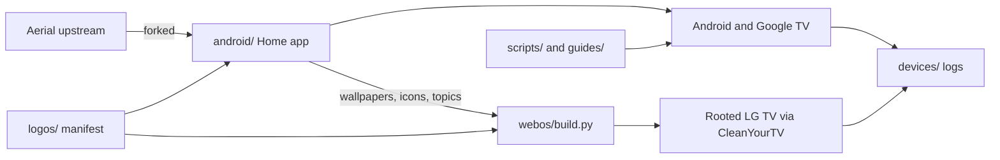

# Architecture

- **`android/`** is the source of truth for design, wallpapers and icons. App structure is in [android/docs/ARCHITECTURE.md](../android/docs/ARCHITECTURE.md).
- **`webos/`** reuses Android data at build time. Video on webOS sits on a hardware plane, so frost is baked ahead of time.
- **`logos/manifest.json`** maps each brand to its Android and webOS app IDs. Artwork stays outside git.
- **`scripts/` and `guides/`** prepare a TV. **`devices/`** records what happened.
